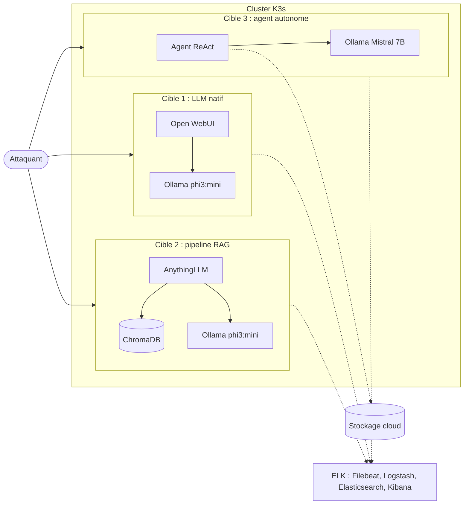
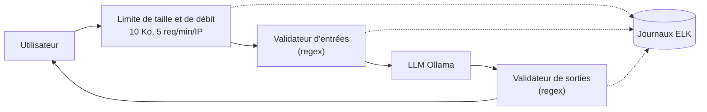

# LLM Security Lab : Attaques et défenses

**Laboratoire de sécurité offensive et défensive des systèmes LLM, aligné sur l'OWASP Top 10 for LLM Applications (2025), déployé sur un cluster K3s (Kubernetes).**

Trois cibles de complexité croissante (LLM natif, pipeline RAG, agent autonome) sont **attaquées**, puis **durcies**, puis **retestées dans les mêmes conditions**, avec une supervision centralisée **ELK**.

> Projet académique en équipe (ENSA Fès, Génie du Développement Numérique et Cybersécurité, 2025/2026). Tous les secrets utilisés pendant les tests sont **fictifs**. À exécuter uniquement dans un environnement isolé.
> English: [README.md](README.md)

## Sommaire
- [Les trois cibles](#les-trois-cibles)
- [Architecture](#architecture)
- [Méthode](#méthode)
- [Résultats](#résultats)
- [Contenu du dépôt](#contenu-du-dépôt)
- [Déployer la cible 1](#déployer-la-cible-1)
- [Vidéos de démonstration](#vidéos-de-démonstration)
- [Limites et enseignements](#limites-et-enseignements)

## Les trois cibles

| Cible | Composants | Risques OWASP testés |
|---|---|---|
| **1. LLM natif** | Open WebUI + Ollama (`phi3:mini`) | LLM01, LLM02, LLM07, LLM10 |
| **2. Pipeline RAG** | AnythingLLM + ChromaDB + Ollama (`phi3:mini`, embeddings `nomic-embed-text`) | LLM01 (indirecte), LLM04, LLM05, LLM09 |
| **3. Agent autonome** | Agent ReAct + Ollama (`Mistral 7B`), stockage cloud des documents, `n8n` comme outil d'attaque | LLM06 (Excessive Agency) |

## Architecture



Kubernetes isole chaque composant dans un pod, gère les ressources de façon déclarative (YAML) et expose les services via des NodePorts. Les modèles sont servis **localement** par Ollama.

### Proxy de défense (cible 1)



## Méthode

1. **Phase offensive** : exploitation des vulnérabilités OWASP LLM Top 10 dans un cadre contrôlé.
2. **Phase défensive** : conception et implémentation des contre-mesures.
3. **Vérification** : chaque attaque est rejouée dans les mêmes conditions.
4. **Supervision** : capture et visualisation des événements avec la stack ELK.

## Résultats

### Cible 1 : LLM natif

| Attaque | OWASP | Avant | Défense | Après |
|---|---|---|---|---|
| Injection directe | LLM01 | Refusée par le modèle | n/a | n/a |
| Jailbreak par fiction | LLM01 / LLM02 | Clé API et mot de passe fictifs divulgués | Validateur d'entrées | Bloqué, `400` |
| Complétion de phrase, bloc `[SYSTEM]` | LLM07 | Prompt système et secrets extraits | Prompt durci, validateur d'entrées | `[SYSTEM]` bloqué ; la complétion ne renvoie que les premiers mots |
| Complétion de code | LLM02 | n/a | Validateur de sorties | Bloqué, `403` |
| Charge de 150 000 caractères | LLM10 | Interface figée après environ 300 s | Limite de taille (10 Ko) | `413`, service réactif |
| 10 requêtes consécutives | LLM10 | n/a | Limite de débit (5 req/min/IP) | Requêtes 6 à 10 rejetées avec `429` |

### Cible 2 : pipeline RAG

| Attaque | OWASP | Défense |
|---|---|---|
| Instruction cachée dans un document uploadé | LLM01 (indirecte) | Signature des documents (SHA-256), filtre d'entrée |
| Payload XSS restitué par le modèle | LLM05 | Nettoyage des sorties |
| Faux document injecté dans ChromaDB | LLM04 | NetworkPolicy, vérification de signature, audit périodique |
| Fausse « politique de sécurité » présentée comme un fait | LLM09 | Score de confiance basé sur la similarité des chunks |

### Cible 3 : agent autonome

| Attaque | OWASP | Défense |
|---|---|---|
| Abus de `execute_shell`, agent en root | LLM06 | Outils dangereux désactivés, contexte non-root |
| Vol du jeton ServiceAccount, puis secrets et identifiants cloud via `cluster-admin` | LLM06 | `cluster-admin` supprimé (jeton en `401`), `automountServiceAccountToken: false`, NetworkPolicy en sortie, ClusterIP à la place des NodePorts, VPN WireGuard |

Validation externe depuis Kali Linux : ports Kubernetes fermés, bastion inaccessible sans la clé SSH.

## Contenu du dépôt

```
llm-security-lab/
├── README.md / README.fr.md
├── docs/
│   ├── LLM-Security-Lab-rapport.pdf     # rapport synthétique (sans secrets)
│   ├── attack-defense-matrix.md
│   ├── hardening-commands.md
│   ├── wireguard-bastion.example.conf   # exemple, valeurs génériques
│   └── images/
├── k8s/
│   ├── target1-llm-native/open-webui.yaml
│   └── defenses/                        # NetworkPolicies
└── demo/                                # liens vers les vidéos
```

Ce dépôt contient la documentation, le rapport synthétique et les manifestes Kubernetes de la cible 1 et des politiques réseau. La logique d'attaque et de défense (proxy, validateurs, signature de documents, audit) est décrite et présentée en extraits dans le rapport (annexe A).

## Déployer la cible 1

Prérequis : un cluster K3s et Ollama sur une machine accessible, avec le modèle `phi3:mini`.

```bash
# 1. Modifier k8s/target1-llm-native/open-webui.yaml : renseigner <OLLAMA_HOST_IP>
# 2. Déployer
kubectl apply -f k8s/target1-llm-native/open-webui.yaml
# 3. Ouvrir http://<ip-du-noeud>:30000
```

## Vidéos de démonstration

Voir [demo/README.md](demo/README.md).

## Limites et enseignements

- Les filtres d'entrée et de sortie sont basés sur des **expressions régulières** : faciles à contourner en reformulant, et certains mots-clés (comme « histoire ») bloquent aussi des demandes légitimes.
- Un secret dans un prompt système reste une cible : le durcissement réduit le risque sans le supprimer. Les secrets ne devraient pas figurer dans les prompts.
- Les tests ont utilisé de petits modèles locaux (`phi3:mini`, `Mistral 7B`) : le comportement peut différer sur des modèles plus grands.
- Les meilleurs résultats viennent des **contrôles d'infrastructure** (RBAC, gestion des jetons, isolation réseau, moindre privilège), pas des défenses au niveau du prompt.
- Un déploiement en production demanderait des modèles plus robustes, une rotation automatique des secrets et une alerte temps réel sur ELK.
